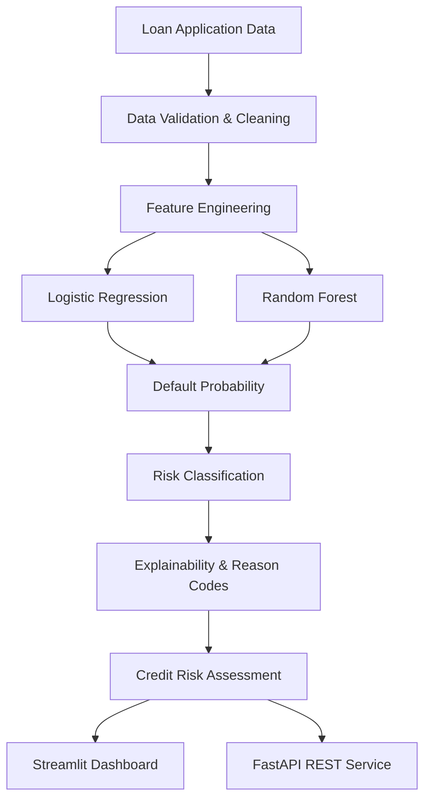

# Explainable AI-Based Credit Risk and Loan Default Prediction System

**Assess Credit Risk. Predict Loan Defaults. Enable Transparent Lending Decisions.**

## Project Overview

An end-to-end machine learning system designed to assess loan default risk, estimate borrower default probabilities, and provide interpretable insights to support credit risk assessment and lending decisions. The system integrates financial data analysis, predictive modelling, and explainable AI techniques to evaluate borrower credit profiles, identify potential default risks, and classify loan applications into different risk categories. It leverages supervised machine learning algorithms, including **Logistic Regression and Random Forest**, to analyse financial, credit, and employment-related attributes, estimate default probabilities, and generate risk-based insights.

An interactive **Streamlit dashboard** and **FastAPI-based REST API** provide capabilities for loan risk assessment, portfolio analysis, prediction monitoring, and explainable credit evaluation.

## Key Objectives

- Develop machine learning models to predict potential loan defaults.
- Estimate borrower default probabilities using financial and credit-related attributes.
- Classify loan applications into Low, Medium, and High-risk categories.
- Identify important financial and behavioural indicators associated with default risk.
- Improve prediction transparency through explainable risk indicators.
- Support consistent, data-driven credit risk assessment.

## Key Features

| Feature | Description |
|---|---|
| Loan Default Prediction | Supervised machine learning-based loan default classification. |
| Default Probability Estimation | Predict the probability of potential loan default. |
| Credit Risk Classification | Categorize applications into Low, Medium, and High-risk levels. |
| Financial Risk Analysis | Evaluate income, loan amount, debt-to-income ratio, and credit characteristics. |
| Explainable AI | Provide feature contribution summaries and human-readable reason codes. |
| Data Preprocessing | Validate, clean, and prepare financial and credit-related data. |
| Model Evaluation | Assess predictive performance using classification and probability metrics. |
| Interactive Dashboard | Explore loan applications, risk distributions, and portfolio-level insights. |
| REST API | Provide individual loan risk predictions through FastAPI. |
| Synthetic Data Generation | Generate reproducible loan application datasets for experimentation. |

## System Architecture

The system follows a structured machine learning workflow integrating financial data preprocessing, predictive modelling, risk classification, and explainability.



## Machine Learning Architecture

The system uses supervised machine learning techniques to evaluate loan default risk and identify patterns associated with borrower repayment behaviour.

### Supervised Learning

| Algorithm | Purpose |
|---|---|
| Logistic Regression | Baseline loan default classification and probability estimation. |
| Random Forest | Non-linear credit risk classification using multiple decision trees. |

### Predictive Outputs

- Default probability.
- Predicted loan default classification.
- Borrower risk category.
- Important risk indicators.
- Explainable prediction summaries.

## Credit Risk Assessment Indicators

The system analyses multiple financial, credit, and employment-related attributes to evaluate borrower risk.

**Financial Indicators**
- Annual income.
- Loan amount.
- Loan term.
- Interest rate.
- Debt-to-income ratio.
- Credit utilization.

**Credit Profile Indicators**
- Credit score.
- Previous loan delinquencies.
- Existing financial obligations.
- Credit repayment history.

**Employment Indicators**
- Employment duration.
- Employment stability.

**Loan Information**
- Loan purpose.
- Borrowing requirements.
- Requested loan amount.

These indicators help assess borrower financial profiles and identify characteristics associated with potential default risk.

## Risk Classification

Loan applications are categorized according to their estimated default probabilities.

| Risk Category | Interpretation |
|---|---|
| Low Risk | Relatively lower estimated probability of default. |
| Medium Risk | Moderate estimated probability of default. |
| High Risk | Higher estimated probability of default. |

*Risk classification thresholds should be established and calibrated using validation data. These categories are analytical indicators and should not independently determine lending decisions.*

## Explainable AI

Explainability is incorporated to improve the transparency and interpretability of credit risk predictions.

The current baseline implementation provides:

- Feature-based risk indicators.
- Human-readable reason codes.
- Financial attribute-based explanations.
- Prediction summaries for individual loan applications.

The explainability module uses rule-based reason codes, such as elevated debt-to-income ratios or previous delinquencies, to support model review.

**SHAP-based feature attribution is a potential future enhancement** and should only be claimed as implemented once integrated and validated.

*Generated reason codes are indicative analytical explanations, not legally sufficient adverse-action reasons.*

## Technology Stack

| Category | Technologies |
|---|---|
| Programming | Python |
| Data Processing | Pandas, NumPy |
| Machine Learning | Scikit-learn |
| Predictive Modelling | Logistic Regression, Random Forest |
| Explainable AI | Feature Contribution Analysis, Rule-Based Reason Codes |
| Data Visualization | Matplotlib |
| Interactive Dashboard | Streamlit |
| Backend Development | FastAPI, Uvicorn |
| Model Management | Joblib |
| Testing | Pytest |
| Development Environment | Jupyter Notebook, VS Code |
| Version Control | Git, GitHub |

## Methodology

1. **Data Generation & Collection** – Generate or load loan application records.
2. **Data Validation** – Validate required fields, data types, and permissible ranges.
3. **Data Preprocessing** – Handle missing values and prepare financial and credit-related attributes.
4. **Feature Engineering** – Develop affordability, financial stability, and credit-behaviour features.
5. **Data Splitting** – Separate training and holdout datasets.
6. **Model Development** – Train Logistic Regression and Random Forest classifiers.
7. **Probability Estimation** – Generate borrower default probabilities.
8. **Risk Classification** – Assign applications to appropriate risk categories.
9. **Explainability** – Generate feature-based risk indicators and reason codes.
10. **Model Evaluation** – Evaluate classification performance and probability estimates.
11. **Dashboard & API Integration** – Present predictions and analytical insights through interactive applications.

## Model Evaluation

The system evaluates predictive performance using classification and probability-based evaluation metrics.

| Metric | Purpose |
|---|---|
| Accuracy | Measures overall classification correctness. |
| Precision | Measures the proportion of predicted defaults that are actual defaults. |
| Recall | Measures the proportion of actual defaults correctly identified. |
| F1-Score | Balances precision and recall. |
| ROC-AUC | Evaluates classification ranking performance. |
| Confusion Matrix | Examines correct and incorrect classifications. |
| Calibration | Evaluates how closely predicted probabilities match observed default frequencies. |

*Model evaluation should use properly separated validation and test datasets. Probability calibration should be assessed independently of classification accuracy.*

## API Usage – Loan Risk Prediction

The FastAPI service provides a `/predict` endpoint that accepts financial, credit, and employment-related information through a POST request.

### Key Input Parameters

- **Financial Details:** Annual income, loan amount, loan term, and interest rate.
- **Credit Profile:** Credit score, debt-to-income ratio, credit utilization, and previous delinquencies.
- **Employment Details:** Employment duration in years.
- **Loan Information:** Loan purpose and borrowing requirements.

### Expected API Outputs

- Predicted loan default classification.
- Estimated probability of default.
- Borrower risk category.
- Financial risk indicators.
- Explainable prediction summaries.

API documentation:

`http://127.0.0.1:8000/docs`

## Installation & Quick Start

**1. Clone the repository**

```bash
git clone <your-repository-url>
cd <repository-folder>
```

**2. Create a virtual environment**

```bash
python -m venv venv
```

**3. Activate the environment**

Windows:

```bash
venv\Scripts\activate
```

Linux / macOS:

```bash
source venv/bin/activate
```

**4. Install dependencies**

```bash
pip install -r requirements.txt
```

**5. Generate synthetic loan application data**

```bash
python scripts/generate_data.py
```

**6. Execute the machine learning pipeline**

```bash
python scripts/run_pipeline.py
```

**7. Launch the Streamlit dashboard**

```bash
streamlit run dashboard/app.py
```

**8. Start the FastAPI backend**

```bash
uvicorn api.main:app --reload
```

**9. Run automated tests**

```bash
pytest -q
```

*Ensure the commands and file paths match the actual repository implementation.*

## Repository Structure

```text
Credit_Risk_Analysis/
│
├── api/
│   └── main.py
│
├── config/
│   └── config.yaml
│
├── dashboard/
│   └── app.py
│
├── data/
│   ├── sample/
│   │   └── loan_applications.csv
│   └── processed/
│
├── docs/
│   ├── 01_project_overview.md
│   ├── 02_problem_statement.md
│   ├── 03_objectives_and_scope.md
│   ├── 04_literature_review.md
│   ├── 05_system_architecture.md
│   ├── 06_methodology.md
│   ├── 07_dataset_documentation.md
│   ├── 08_feature_engineering.md
│   ├── 09_model_development.md
│   ├── 10_credit_risk_assessment.md
│   ├── 11_explainable_ai.md
│   ├── 12_model_evaluation.md
│   ├── 13_api_documentation.md
│   ├── 14_dashboard_guide.md
│   ├── 15_testing_and_validation.md
│   ├── 16_security_and_privacy.md
│   ├── 17_deployment_guide.md
│   ├── 18_limitations_and_future_work.md
│   └── 19_references.md
│
├── notebooks/
│   ├── 01_data_exploration.ipynb
│   ├── 02_data_preprocessing.ipynb
│   ├── 03_feature_engineering.ipynb
│   ├── 04_logistic_regression.ipynb
│   ├── 05_random_forest.ipynb
│   └── 06_model_evaluation.ipynb
│
├── scripts/
│   ├── generate_data.py
│   └── run_pipeline.py
│
├── src/
│   └── credit_risk/
│       ├── __init__.py
│       ├── data.py
│       ├── features.py
│       ├── models.py
│       ├── explainability.py
│       ├── policy.py
│       └── pipeline.py
│
├── tests/
│   ├── test_features.py
│   └── test_prediction.py
│
├── .env.example
├── .gitignore
├── LICENSE
├── requirements.txt
└── pyproject.toml
```

## Future Enhancements & Roadmap

- Integrate SHAP-based explainable AI for detailed feature attribution.
- Explore XGBoost and LightGBM for advanced credit risk modelling.
- Implement probability calibration and threshold optimization.
- Introduce model fairness evaluation and bias monitoring.
- Develop temporal validation using historical loan performance data.
- Implement model drift detection and automated retraining.
- Integrate secure database storage and authentication.
- Develop advanced credit portfolio analytics.
- Enable containerized deployment using Docker and cloud infrastructure.

## Security & Responsible AI

This project is an educational and research-oriented credit risk modelling prototype.

- Uses synthetic loan application data by default.
- Does not connect to actual banking or lending infrastructure.
- Avoids using protected attributes or proxies for discriminatory decisions.
- Supports transparency through interpretable risk indicators.
- Requires appropriate fairness testing and model validation.
- Treats predictions as decision-support information rather than definitive lending decisions.
- Requires meaningful human review and appropriate appeal processes.
- Protects personal information and confidential financial records.

Credit risk predictions should never be used as the sole basis for approving or rejecting a loan application.

## Limitations

The current implementation uses synthetic data, simplified target-generation assumptions, baseline machine learning models, and rule-based explanation techniques.

Synthetic-data performance does not establish real-world credit risk prediction effectiveness. Further validation using appropriately authorized, representative datasets is necessary before considering operational use.

## Author

**Mohamed Riyaz S.**  
Integrated M.Tech – Computer Science and Engineering (Business Analytics)  
Vellore Institute of Technology (VIT), Chennai
